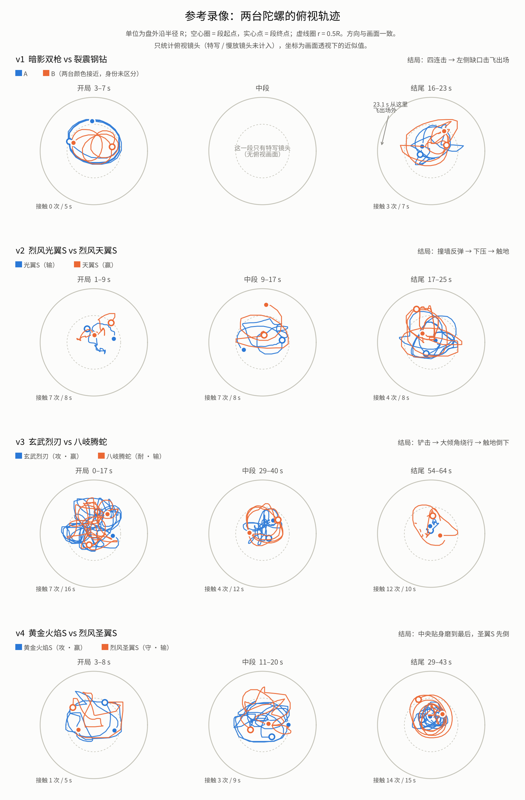

# M4 输入：真实陀螺对战录像分析（4 段）

> 2026-11-11。来源：Huang 提供的 4 段手机录屏（B 站“STARLIGHT书记”，第二届飓风战魂陀螺大赛 / 九曜星内战；金属陀螺，蓝色碗形战斗盘，外沿陡墙带缺口）。
> 本文是 M4（自主运动与 AI）的设计输入，**只记录观察、测量和与当前代码的差异，不改代码，也不预先宣称任何问题已解决**。
> 录像帧不入库；复现脚本在 `scripts/refvideo/`（见文末）。



## 0. 方法与局限

- 每段按 15 fps 抽帧（共 2,606 帧），按画面突变切镜头。俯视镜头内用中值背景分割出两台陀螺，拟合战斗盘外沿椭圆，坐标归一到外沿半径 **R**；
  逐帧关联两条轨迹，按颜色定身份。约 1,550 帧俯视画面参与定量。开局、结尾和解说提到的关键段（含慢放特写）逐帧人工查看。
- 尺度：陀螺半径 ≈ 0.133R；陀螺中心最远到 ≈ 0.68R（P99 0.67），即墙内沿约 0.8R。
  对照：我们的刀刃半径约 0.5、场地半径 5.4，约 0.09；录像约 0.17——录像里的陀螺相对场地更大、场地更“挤”（只记录，不据此提议改场地）。
- 局限：俯视有轻微透视；特写 / 慢放镜头只做定性；接触按“中心距 < 0.28R”估计，15 fps 会漏掉极快的擦碰，接触次数是近似值；
  v1 两台颜色接近，只在开局段区分身份；业余比赛是一个人先后发射（间隔约 1–2 s），开局计时不作参考；特写镜头是否实时无法确认，时长按录像时间计。

## 1. 四场概况

| 录像 | 对阵（定位） | 时长 | 结局 | 胜者 |
|---|---|---|---|---|
| v1 | 暗影双枪（攻）vs 裂震钢钻（走位 / 反击） | 约 21 s | 约 1.2 s 内四连击，从左侧缺口击飞出场 | 裂震钢钻 |
| v2 | 烈风光翼S vs 烈风天翼S（同系，平衡） | 约 24 s | 光翼S 突然失衡乱窜 → 被撞墙反弹 → 天翼S 借冲击弹起下压 → 光翼S 机身触地 | 天翼S |
| v3 | 玄武烈刃（攻）vs 八岐腾蛇（耐） | 约 63 s | 中央吸收战 → 一记铲击 → 八岐腾蛇大倾角绕行约 2.5 s → 撞墙边倒下 | 玄武烈刃 |
| v4 | 黄金火焰S（攻）vs 烈风圣翼S（守） | 约 40 s | 圣翼S 被连击打出倾角后带倾角作战约 20 s，最后在中央贴身磨到先倒 | 黄金火焰S |

## 2. 定位（类型）与站位

各阶段的半径与速度（中位数；R = 外沿半径，速度单位 R/s）：

| 录像 | 陀螺 | 开局 半径 / 速度 | 中段 半径 / 速度 | 结尾 半径 / 速度 |
|---|---|---|---|---|
| v1 | A（大圈的一台，按解说为暗影双枪） | 0.50 / 2.20 | （只有特写） | 两台合计约 0.31 / 0.9 |
| v1 | B | 0.33 / 1.29 | | |
| v2 | 光翼S（输） | 0.25 / 0.23 | 0.38 / 0.56 | 0.33 / 1.50 |
| v2 | 天翼S（赢） | 0.25 / 0.22 | 0.15 / 0.07（段末 1/3：1.98） | 0.41 / 1.54 |
| v3 | 玄武烈刃（攻，赢） | 0.35 / 1.40 | 0.23 / 0.76 | 0.14 / 0.11 |
| v3 | 八岐腾蛇（耐，输） | 0.32 / 0.79 | 0.36 / 0.61 | 0.31 / 0.24（段末 1/3：1.02） |
| v4 | 黄金火焰S（攻，赢） | 0.41 / 1.73 | 0.35 / 1.55 | 0.21 / 0.79（段末 1/3：0.37） |
| v4 | 烈风圣翼S（守，输） | 0.30 / 0.69 | 0.40 / 0.55 | 0.28 / 0.86（段末 1/3：0.28） |

- **攻击型**（暗影双枪、玄武烈刃、黄金火焰S）：开局在外圈大圈高速绕行，半径 0.35–0.50R（可活动半径的 50–75%），速度 1.4–2.2 R/s，一圈约 1.5–2 s，从外圈切入撞击。
- **持久 / 防御型**（八岐腾蛇、烈风圣翼S）：想占中央（“一上场想占据战斗盘中央”“在中央盘踞”“将冲击全数吸收”），速度约为攻击型的 40–60%。
  被持续压制时转到外圈绕行躲避（v3 中段：八岐腾蛇半径 0.36、稳定同向绕行，攻击方反而在中央 0.23），之后再回中央。
- **平衡 / 反击型**：v2 同系两台开局在中央贴身缠斗（半径 0.25R、速度约 0.2 R/s、约每秒一次轻碰）；
  v1 裂震钢钻先“走位躲避”“放风筝耗持久”，攻击方转速下降后再主动进攻，四连击击飞。
- **站位是速度的结果**：1 秒窗口统计（356 个），速度 < 0.4 R/s 时平均半径 0.19R，0.4–1.8 R/s 时 0.28–0.34R，> 1.8 R/s 时 0.44R，相关系数 0.52。
  碗形盘面上跑得越快越靠外，慢下来就滑回中央——“攻击型在外圈、持久型在中央”主要是 轴心牵引 → 速度 → 碗面平衡半径 的物理结果，不是选点。
- 绕场方向每台基本固定（v1 两台开局 100% 逆时针；v4 攻击方 93% 顺时针），同一场两台多为同向。v1/v2 与 v3/v4 方向相反，可能是旋向不同或画面翻转，录像上分辨不了。

## 3. 开局

- 先落地的一台先占位（业余比赛先后发射，不作参考；我们是同时发射）。
- 落地后 1–2 s 内各自进入本位：攻击型立刻外圈大圈，防守型去中央，同系平衡型直接贴身。
- 第二台落地到第一次接触：v2 约 1 s，v4 约 2 s，v3 约 2.7 s（攻击方“一进场就发动连续的进攻”，2.9 s、3.4 s 两次接触），v1 超过 5 s（裂震钢钻在躲）。
  开局不是固定的“对冲一下”，而是先建立位置。

## 4. 战斗方式与攻击方式

攻击手段（解说 + 画面）：

1. **外圈蓄力冲撞**：沿外圈加速后切进来撞（v4 “第二阶段环绕大幅度移动”：中段火焰S 1.55 R/s、绕心 3.7 rad/s，圣翼S 0.55 R/s）。
2. **连击**：1–2 s 内连续 3–7 次接触（v1 四连击、v4“近乎七连打击”、v3 开局连续进攻）。v1 慢放把四下的作用讲得很清楚：
   第一下消耗持久 → 第二下把对方撞到墙边、限制走位 → 第三下打歪（破坏平衡）→ 第四下击飞出场。
3. **推着走**：持续贴身，一下一下把已经倾斜的对手顶着走（v4 约 23–24 s）。
4. **追击**：对方被打歪、跑到外圈“找回平衡”时连续跟进，用重击继续加大倾角（v4 约 30–35 s）。
5. **铲击**：从下方铲，把低转速、已摇摆的对手掀歪（v3 60.3 s 的终结一击）。
6. **借墙**：把对方撞上墙反弹，自己借冲击力弹起下压（v2 终结）。
7. **轻击缠斗**：贴身连续轻碰、找身位破绽（v2 开局与中段，约 0.9 次/s）。

防守 / 持久方的应对：中央吸收；被压制时转外圈绕行躲避；倾斜后去外圈“找回平衡”；后段把对手“拉入中央吸收战”；最后“拉近距离同归于尽”。

节奏随时间的变化：

- **攻击型的移动由大变小**：v3 玄武烈刃 1.40 → 0.76 → 0.11 R/s、半径 0.35 → 0.23 → 0.14（解说：“旋转力下降，由大幅度移动变为在中央进行小幅度移动”）；
  v4 火焰S 1.73 → 1.55 → 0.79（段末 0.37）。收缩出现的早晚与消耗有关：v3 攻击方开局连续进攻，中段就已收缩；v4 攻击方中段仍接近开局。
- **节奏会突然变快**：v2 前约 15 s 两台在中央慢速缠斗（0.1–0.4 R/s），解说“开启攻击模式”后速度跳到 1.5–2.0 R/s。
  机制（机关切换还是倾斜后接触点外移）录像上分辨不了；能确定的是**移动强度不随转速单调下降**。
- **越到后面越往中央挤、接触越密**：v3 结尾段约 1.2 次/s（开局 0.43、中段 0.34）；v4 结尾段约 0.95 次/s（开局 0.21、中段 0.33）。

## 5. 结束过程（重点）

逐场时间线：

- **v1 击飞**（实时 22.0–23.2 s，慢放 26–30 s）：中央相撞 → 被撞到左下墙边、明显倾斜（22.4–22.6 s）→ 大幅摇摆着贴墙移动（22.8–23.0 s）→ 从左侧缺口飞出场外（23.2 s）。
  赢方继续在场内正常转。
- **v2 触地**：22.0 s 光翼S 突然大幅倾斜摇摆（“哇什么情况”）；之后约 3 s 倾斜着高速乱窜（结尾段 1.5 R/s）、撞墙反弹；
  慢放：天翼S 把它撞向墙，自己借冲击力弹起、下压，光翼S 机身触地停下。
- **v3 触地倒下**：结尾段两台都已低速挤在中央（玄武烈刃几乎原地，0.11 R/s），约 1.2 次/s 的贴身接触；八岐腾蛇先出现明显摇摆（“快要到达极限了”，58.5–59.9 s）；
  60.3 s 一记铲击后，它大倾角绕着对方转了一大圈（60.5–62.9 s，速度反而升到约 1 R/s，按三分段中位数是它全场最快的一段），边缘刮地，到右侧墙边倒下（63–63.7 s）。
  玄武烈刃在中央直立慢转。
- **v4 中央磨到底**：圣翼S 约 20 s 起就被连击打出倾角，“倾角过大” → 去外圈“找回平衡” → 被“连续追击”“重量级进攻”继续加大倾角 → “凭借强大支撑力苦苦坚持、拉近距离”；
  最后约 5 s 两台在中央几乎一直贴着（接触约每 0.5 s 一次；最后约 2.7 s 只有 0.1–0.4 s 的短暂分开，单段连续接触最长约 1.2 s），两台作为一对慢慢绕着转（绕心约 2 rad/s），圣翼S 倾角越来越大，火焰S 获胜。

共同规律：

1. **结束是一个过程**：从“明显失衡”到“出场 / 倒下”约 1–3 s（击飞约 1.2 s、死亡绕行约 2.5 s、失衡乱窜约 3 s）；更早的“带伤作战”可以持续很久（v4 约 20 s）。
2. **输方有清楚的视觉信号**：倾角越来越大（俯视能看到侧面）、摇摆、路线变乱、撞墙反弹；转速低时反而可能跑得更快——倾斜后边缘吃地。
3. **致命一击落在已经失衡的一方**：四场的最后一下（第四击 / 下压 / 铲击 / 贴身磨）都发生在对方已经明显倾斜之后，没有一场是“一下从满状态直接结束”。
4. **赢方仍然直立、看得出在转**，多半在中央。
5. **贴在一起的结尾也有（v4），但不是“定住”**：一直在绕、倾角一直在变、中间有短暂分开，直到一台倒下。
6. **结束方式和类型组合有关**：攻 vs 反击 → 击飞；同系平衡 → 失衡后被下压触地；攻 vs 耐 → 中央吸收战后触地；攻 vs 守 → 长时间带倾角对抗后磨倒。

## 6. 对照当前实现（代码事实，`src/game/beys/BeyPhysics.ts` 的 `preStep`）

| 方面 | 录像 | 当前代码 |
|---|---|---|
| 低转速时的倾角 | 越慢越歪，摇摆锥越来越大，最后边缘触地 | 目标倾角 `lean = bit.drift × min(1, 转速 / (0.5 × 发射转速))`：转速低于发射的一半后目标倾角**变小**，被拉向竖直（方向相反） |
| 移动强度随转速 | 本位（大圈 / 中央）保持到消耗明显之后才收缩；失衡时可能更快 | 牵引加速度 `driveAccel × 抓地 × 转速比`，速度上限 `driveSpeed × 抓地 × (0.35 + 0.65 × 转速比)`：从开局就随转速线性下降 |
| 自稳 | 高转速时撞歪很快恢复；接近临界时恢复慢、晃动大 | `s = clamp((转速 − minStableSpin) / (0.3 × 发射转速))`：只在最后约 30% 区间减弱——方向一致，但被上面两条抵消 |
| 进动 | 转速越低进动越快 | `precessBase + precessSpin / max(20, 转速)`：一致 |
| 倾斜刮地 | 边缘触地 → 倒下 / 停转 | 倾角 > 0.5 rad 时额外掉速：一致，但目标倾角在变小，很少走到这一步 |
| 自转条（血量） | — | HUD“自转” = 转速 / 发射转速，线性 |

- 已知失败的旧测试 P2.3.1（球头对球头最长僵持 15.5 s）与“结尾不自然”同一类问题：录像里贴身段一直在动，单段连续接触最长约 1.2 s，贴身期（含短暂分开）最长约 2.7 s。
- 真机反馈“磐盾太强”：录像里攻击方赢防守 / 持久方靠的是**连续命中积累倾角**（每一下让对方更歪，对方转速越低恢复越慢）和**把失衡的对手逼到墙边 / 缺口**。
  我们这边，单次撞击后的倾角恢复时间还没有测过（待测）；击飞方向与口袋方位无关已在 M5b 测过（进口袋比例 19% / 26% ≈ 口袋占比）。

## 7. 对 M4 的含义（草案，Huang 确认方向后再预注册）

1. **结束过程**：低转速时倾角变大而不是变小（进动锥随转速下降张开）；倾斜后接触点外移带来牵引（死亡绕行）；边缘触地后停转 / 倒下。
   全部用力矩、摩擦实现：不注入速度、不强制朝向、不瞬移、不脚本化碰撞。
2. **自转条 = 转速（仍线性显示），表现按“30% 以上平台、以下平滑下降”**：转速比 ≥ 0.3 时牵引、稳定性、显示的转动与满转速接近；低于 0.3 后平滑下降并伴随倾角增大。
   依据是陀螺仪的规律（稳定性随转速增大，远高于临界转速时看不出差别），不是表演层的假象。
3. **轨迹多样性**：由轴心决定本位（平头 / 橡胶 → 外圈大圈；针尖 / 球头 → 中央），后段收缩；碰撞后有可见偏折和撞墙反弹。
4. **攻击方式**：AI 意图增加“连击 / 追击 / 逼墙”，仍只通过进动相位调制牵引方向，不施加额外的力；配合 M5b 计划 §5 的出击角度。
5. **候选验收指标**（场地可活动半径与比赛阶段归一，先测当前版本作为基线，再按预注册规则判定）：
   - E1 结束过程：输方从“倾角持续超过自然倾角 + 0.25 rad”到结束的时长中位 1–4 s，期间倾角整体上升，结束时赢方倾角小于输方。
   - E2 表现曲线（设计要求）：转速比 0.3–1 区间的平均移动速度差 ≤ 15%；0.3 以下平滑下降，无阶跃。
   - E3 后段接触变密：最后 10 s 的接触频率 ≥ 中段的 2 倍（录像约 3 倍）。
   - E4 定位差异：攻击型开局速度 / 防守型 ≥ 1.5（录像 1.7–2.5）；半径比 ≥ 1.1（录像 1.1–1.5）。
   - E5 贴身不冻结：连续接触段最长 < 3 s（录像单段最长约 1.2 s，贴身期最长约 2.7 s），接触期间两台的相对方位持续转动。
   - 平衡指标（胜率、自灭、时长）沿用 M5 的门槛。

## 附：复现

```bash
# 1) 每段录像抽帧（15 fps，宽 960），每段一个目录：$REFVIDEO_DIR/v1/f15/00001.jpg …
ffmpeg -i v1.mp4 -vf "fps=15,scale=960:-2" $REFVIDEO_DIR/v1/f15/%05d.jpg
# 2) 切镜头 + 俯视镜头内检测两台陀螺（输出 track2.json 与调试图）
python3 -I scripts/refvideo/track.py $REFVIDEO_DIR/v1/f15 $REFVIDEO_DIR/v1/track2.json $REFVIDEO_DIR/v1/dbg2
# 3) 连轨迹、算指标（各段录像的分析区间与身份判别写在 metrics.py 的 VIDEOS 里），再画图
REFVIDEO_DIR=... python3 -I scripts/refvideo/metrics.py
REFVIDEO_DIR=... python3 -I scripts/refvideo/plot_paths.py
# 逐帧人工查看用的拼图
python3 -I scripts/refvideo/sheet.py $REFVIDEO_DIR/v3/f15 v3_end.jpg 878 968 3
```

依赖：Python 3、OpenCV、NumPy、Matplotlib（只用于离线分析，不进游戏构建，不进 CI）。
