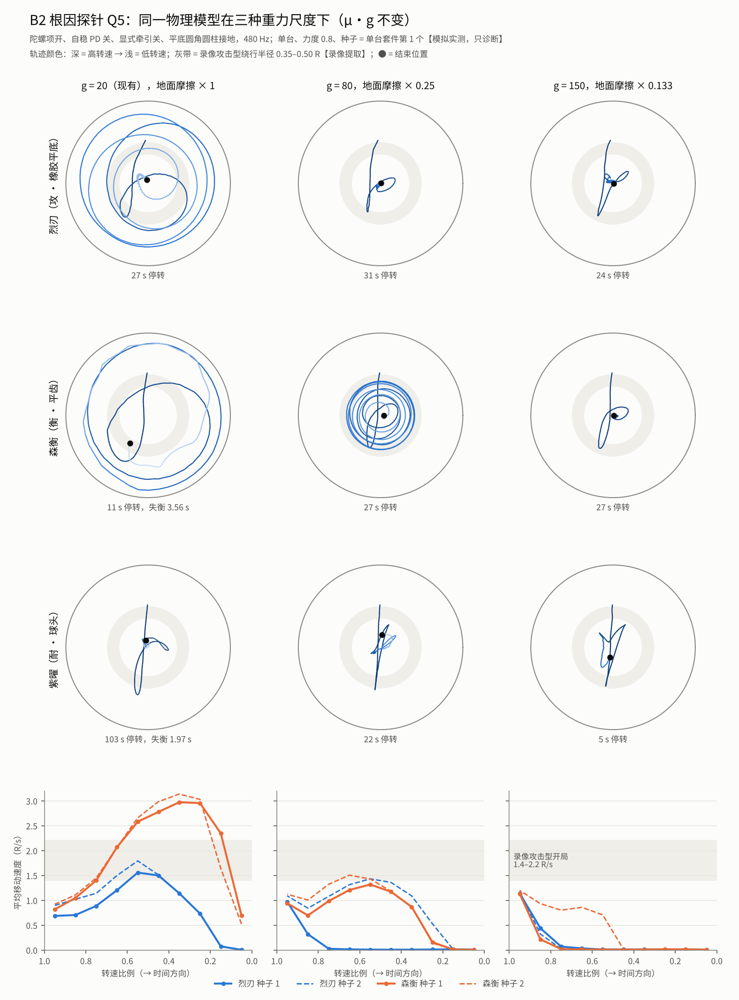

# M4 结果记录

> 按 `m4-experiment-plan.md` 的预注册规则逐步追加；每节写明 CI run、提交、结论与依据。数据标注同 M4-A：【模拟实测】【录像提取】【推断】。

## B0 陀螺项（工程前提）——通过

CI run 43032445298（提交 ac8e8c5），`tests/gyro.test.ts`【模拟实测】：

| 测试 | 门槛 | 结果 |
|---|---|---|
| T0 纯逻辑：无力矩对称刚体 240 步 | 角动量 / 动能漂移 < 1e-9 | 机器精度（≤ 3e-14） |
| T1 无重力自由圆盘 2 s | 补上 < 0.1%；Rapier 单独 > 1% | 补上 1.2e-4；Rapier 单独 3.78% |
| T2 重陀螺进动（ω = 8 ω_c = 123.8 rad/s） | 与 m g l / (I_a ω) = 0.3878 相差 < 10% | 0.3896 rad/s（+0.5%）；Rapier 单独 0.7455（快 1.92 倍 ≈ I_a / I_t，与 M4-A 的分析一致） |
| T2 稳定 / 失稳 | 1.5 ω_c 最大倾角 < 0.4；0.6 ω_c > 1 rad | 0.267；1.860 |
| T3 场地内四构筑（陀螺项开、PD 关） | 无 NaN、账本残差 ≤ 1%、2 s 不倒 | 全部通过（残差 ≤ 4e-16）；森衡 10 s 内停转（见 B1） |

默认开关下 golden 180 场逐场一致；单元测试除已知的 P2.1、P2.3.1 外全部通过。

## B1 物理自稳——未通过（筛选集，不跑确认集）

CI run 43032445298 诊断任务（job 130562835710）。开关：陀螺项开、PD 关、牵引方向取实际倾斜（大小乘接地点偏移比例）、意图调制暂停【模拟实测】。

| 指标 | 门槛 | M4-A | B1 |
|---|---|---|---|
| E1a 有失衡过程 | ≥ 80% | 67.5% | **78.3%** ✗ |
| E1b 失衡过程中位 | 1–4 s | 0.68 s | 1.50 s ✓ |
| E1c 倾角上升 | ≥ 70% | 86% | **58.6%** ✗ |
| E1d 赢方倾角低于输方 | ≥ 90% | 98% | 92.3% ✓ |
| E2 速度曲线（烈刃 / 森衡 / 紫曜 0.5 档比） | ≥ 0.65 | 0.45–0.60 | 0.81 / 1.01 / 0.83 ✓（只报告） |
| E3 垂死速度比 | ≥ 0.5 | 0.05–0.16 | 0.52 / 0.76 / 0.61 ✓（只报告） |
| E4 恢复时间 中 / 高 | ≥ 1.3 | 0.94 | 1.00 ✗（只报告） |
| E5 贴住不动 < 3 s | ≥ 99% | 100% | 100% ✓ |
| 全程不退化 | — | — | 全部通过（自灭 3.1% ≤ 3.6%） |

其他变化：最后 10 s / 中段接触频率中位 3.0（M4-A 1.0，录像约 3）；最后一击落在已失衡一方 27.7%（7.5%）；逼墙 9.4%（1.2%）；
爆裂 0 场（20.3%），每回合撞击 1.9 次（6.6）——意图调制暂停后主动接触大减；森衡胜率 0.8%。

根因：陀螺贴着外圈跑（半径 4.0–4.6，相对地面倾角 0.4–0.6 rad），掉速来源里 Rapier 接触损失占 58–82%、合成刮地 17–30%；
森衡单台 5.5 s、紫曜 22.6 s 就停转（M4-A 24.0 s / 86.0 s）。去掉 PD 后转轴接近竖直、相对地面倾角 ≈ 坡度角，显式牵引在这个倾角下是满额，把陀螺推上墙。
按计划 §4.1 登记 B2（独立定义）。

## B2 接地几何——未通过（筛选集，不跑确认集）

CI run 43033848425 诊断任务（job 130568263500，提交 0ff8d3e；实现 41d919a）。开关：陀螺项开、PD 关、牵引方向取实际倾斜、平底 / 橡胶轴心圆角圆柱接地、
显式牵引关（牵引只来自 Rapier 接地摩擦）、意图调制暂停【模拟实测】。

| 指标 | 门槛 | M4-A | B2 |
|---|---|---|---|
| E1a 有失衡过程 | ≥ 80% | 67.5% | **18.9%** ✗ |
| E1b 失衡过程中位 | 1–4 s | 0.68 s | 1.74 s ✓ |
| E1c 倾角上升 | ≥ 70% | 86% | 94.4% ✓ |
| E1d 赢方倾角低于输方 | ≥ 90% | 98% | **30.4%** ✗ |
| E2 烈刃 0.5 档 / 0.3 档 / 相邻档最小比 | 0.65 / 0.40 / 0.6 | 0.45–0.60 / 0.17–0.24 / — | 0.83 / 0.53 / **0.42** ✗ |
| E2 森衡 | 同上 | 同上 | 0.89 / 0.48 / **0.24** ✗ |
| E2 紫曜 | 同上 | 同上 | **0.08 / 0.05 / 0.36** ✗ |
| E3 垂死速度比（烈刃 / 森衡 / 紫曜） | ≥ 0.5 | 0.05–0.16 | **0.003 / 0.03 / —**（紫曜 0.5 档已静止） ✗ |
| E4 恢复时间 中 / 高 | ≥ 1.3 | 0.94 | 1.94 ✓（只报告） |
| E5 贴住不动 < 3 s | ≥ 99% | 100% | 100% ✓ |
| 全程不退化 | — | — | 全部通过（自灭 0%、时长中位 22.6 s、到上限 9.1%、开局类型比 3.78、账本残差 1.8e-4、确定性 ✓） |

其他变化：终结 自转 311 / 平局 9，爆裂、出界、极限 0；胜率 烈刃 5.2%、磐盾 86.7%、森衡 25.9%、紫曜 80.0%；每回合撞击 5.9、贴身磨 11.8 次；
签名矩阵里两台很快一起停在中央（中段平均半径 0.6–0.8）贴身磨到一方停转。单台：烈刃 / 森衡转到停都不倒（失衡 0 / 6），紫曜 0.5 档以下原地静止，100 s 以上才停。

### B2 根因探针（只读，`tests/diag/m4b-probe.diag.ts`）

不采用任何开关、不改默认值。CI：Q1–Q3 run 43037223927（提交 6e6fc95）、Q4 run 43038195551（4dfe60c）、Q5 run 43038817940（6ded764）。
探针在 120 Hz 下与 B2 单台套件的 8 组种子逐项相同（终结类型、时刻一致），说明探针自己的步进与测量没有改变物理。全部为单台、力度 0.8、每构筑 2 个种子【模拟实测】。

**Q1 / Q2 物理步长与接地运动学**（B2 开关；探针自己做子步：每个子步 `preStep(dt/k)` + `world.step`）

| | 120 Hz | 240 Hz | 480 Hz |
|---|---|---|---|
| 烈刃 高转速段（比例 > 0.7）轴心接地占比（两个种子） | 0.16 / 0.34 | 0.42 / 0.48 | 0.53 / 0.49 |
| 烈刃 高转速段横向角速度（rad/s） | 15.4 / 8.2 | 4.5 / 6.9 | 3.1 / 6.3 |
| 烈刃 中段（比例 0.3–0.7）速度 u/s · 半径 | 1.0 · 0.7；5.4 · 2.9 | 5.8 · 3.1；7.7 · 4.0 | 7.2 · 3.8；7.8 · 3.9 |
| 森衡 高转速段接地占比 | 0.19 / 0.27 | 0.49 / 0.50 | 0.58 / 0.46 |
| 森衡 中段速度 · 半径 | 0.3 · 0.5；4.9 · 2.6 | 6.5 · 3.5；11.2 · 4.7 | 12.2 · 4.7；12.6 · 4.8 |
| 森衡 终结 | 33 s、29 s 停转 | 31 s 停转；11 s 倾倒 | 11 s、10 s（上外圈轨道后倒下） |
| 紫曜、磐盾 | 三种步长一致：约 10 s 内立直（倾角 < 0.001 rad）、原地不动，转速比例 0.1 左右才倒（约一半）或直接立着停 | 同左 | 同左 |

- 横向角速度每个子步转过的角度等于物理章动 I_a ω_s / I_t · dt（烈刃 I_a / I_t = 1.48：120 Hz 每步 1.7–1.8 rad，240 Hz 0.86，480 Hz 0.43），是真实章动，不是逐步来回跳的数值抖动。
  问题在于 120 Hz 每步转 1.8 rad 的章动与圆角圆柱接地耦合：平底在高转速段 66–84% 的物理步里离地（跳着走），牵引断断续续。**B2 里平底“走不动”主要是 120 Hz 的数值问题**；同种子的结果在 120 Hz 下两极分化（一个种子中段 1.0 u/s、另一个 5.4 u/s）也说明它不收敛。
- 240 / 480 Hz 下接地保持住（中段占比 0.8–1.0），接地点滑移降到轮缘速度的 7–20%（接近纯滚动），Rapier 摩擦（μ_eff = 0.225，加速度上限 μg = 4.5 u/s²）把平底推到 6–12 u/s——**真实摩擦给的牵引并不弱**。
  但 g = 20 的碗面拉不住这个速度：绕行平衡 v² = g·r·tanα 要求在外圈陡坡（半径 3.8–4.8，即 0.7–0.9 R），攻击型贴外圈跑，森衡上外圈轨道后被冲刺推出、10 s 倒下——与 B1 的贴墙是同一机制。录像里攻击型绕行在 0.35–0.50 R、1.4–2.2 R/s【录像提取】。
- 240 与 480 Hz 之间仍有差别（森衡同一种子 31 s 停转 vs 11 s 倒下）：平底的物理接地至少需要 240 Hz，480 Hz 更稳妥。

**Q3 平底静稳定**（不转 / 12 rad/s，放在中央倾斜 θ0 释放 3 s）：烈刃、森衡 0.25 rad 自己立回，0.35 rad 倒下，与几何推算的倾倒角 θs = atan((R − b) / (comY − b)) = 0.30 / 0.27 rad 一致；
12 rad/s 下 0.35–0.5 rad 也大多能立回。球头 / 针尖任何倾角都倒（重心高于球心，静不稳定）。→ 平底“转到停都不倒”是形状决定的静稳定（约 17°），不是数值问题：除非被撞或碗面把倾角推过 θs，否则就立着停。

**Q4 只提高重力**（转速、零件、摩擦系数不变，480 Hz）：g = 60 / 150 时平底先冲到 7–10 u/s，随即在中央进入“原地滚边”状态——轮缘接地几乎不滑，轴以 100–180 rad/s 绕圈，横向角速度 ≈ 0.3 ω_s，几乎不移动；
g = 150 时烈刃 / 森衡寿命缩短到 13–14 s（接地摩擦掉速随 μ·g 增大）。球头 g = 150 在转速比例 0.25–0.29 失衡、0.5–0.7 s 倒下；针尖 g = 150 全程 0.33–0.42 rad 倾斜进动（4–19 rad/s），倾角随转速下降逐渐增大，23 s 停。
理论临界转速比例随 √g：g = 20 / 60 / 150 时为 0.11–0.16 / 0.18–0.28 / 0.29–0.44；发射时的重力进动 0.33–0.49 / 1.0–1.5 / 2.5–3.7 rad/s（合成模型现在是 3.5–7 rad/s）。

**Q5 量纲一致**（提高 g 的同时地面摩擦 × 20 / g：牵引加速度 μg 与接地摩擦掉速不变，只改重力相对摩擦的比例；图 `img/m4b-probe-q5.png`）：

- g = 80：森衡两个种子、烈刃一个种子在 0.33–0.48 R 绕行（录像攻击型 0.35–0.50 R），中段 1.1–1.5 R/s，物理进动约 3 rad/s，**速度从开局一直保持到转速比例约 0.3 才明显下降**——
  这正是“30% 以下才慢慢变弱”的形状，而且来自接地摩擦与陀螺效应（接地点表面速度 ω·d 降到跟不上），不是规定的阈值；烈刃另一个种子在比例 0.8 落进原地滚边。
  紫曜（球头）立不直，全程 0.4–0.6 rad 倾斜进动，合成刮地（倾角 > 0.5 rad 的额外掉速，计划里由 B3 去掉）把它在 22–25 s 内耗尽。
- g = 150：平底 4 / 4 落进原地滚边；球头 5 s 倒下。

### B 阶段小结（2026-11-11）

- B0 通过：引擎现在能做真实陀螺动力学（实验开关，默认关闭，golden 不变）。
- B1、B2 未通过。根因分三层：**数值**——120 Hz 下平底接地不收敛；**尺度**——g = 20 的场地让碗面回中力、重力力矩相对接地摩擦太弱（进动几乎看不见、临界转速只有发射的 11–16%、快陀螺只能贴外圈）；
  **形状 / 理想化**——平底 17° 以内静稳定、球头在完全对称的场地中央完全立直。
- 计划 §4 的后续臂（B3 刮地、B4 脱困）要叠加在已采用的物理臂上，现在没有可叠加的基础；在 120 Hz、g = 20 下继续逐个关合成项不会接近目标。
- Q5 说明物理模型在合适的尺度下能自然给出接近录像的攻击型运动和“高位保持、低位衰减”的曲线，但参数空间里有坏吸引子（原地滚边、贴墙、完全立直），耐力 / 防守型还需要足够的陀螺稳定裕度。
  走纯物理需要把重力、摩擦、转速尺度、轴心形状一起标定，并把物理步频提到 240–480 Hz——这会改变全局手感（下落、弹跳、击飞弧线、对局节奏）与性能，**按约定先报告、等 Huang 决定**（提案见 `m4-experiment-plan.md` §4.2）。
