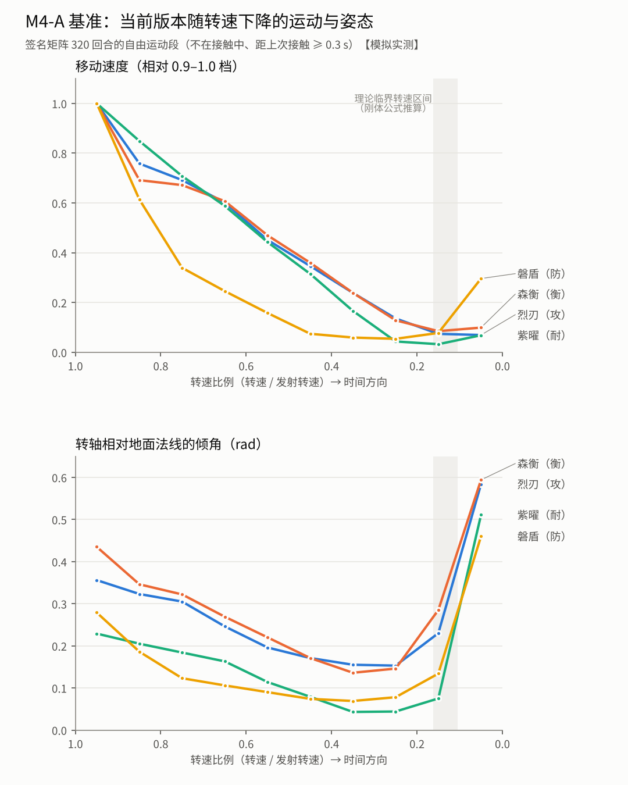

# M4-A 基准报告：当前版本的陀螺生命周期

> 2026-11-11，分支 `v2/s4-motion-ai`，CI run 43029289458（诊断任务 job 130551868010）。**不改游戏代码与参数**。
> 口径：`tests/diag/m4.metrics.ts`（计划文档 §2）；脚本：`tests/diag/m4a-baseline.diag.ts`。
> 数据标注：【模拟实测】= 本仓库物理模拟的测量；【录像提取】= `m4-reference-battles.md` 的录像测量；【推断】= 公式推算或解释。

## 0. 记录不改变结果

签名矩阵 4×4×20（seed 20000+…）加了逐步记录后，320 回合的终结计数与 M5b base 臂逐项相同（自转 246 / 爆裂 65 / 出界 2 / 平局 7）【模拟实测】。
测量只调用 Rapier 的查询接口。

## 1. 结论摘要

1. **Rapier 不积分陀螺项**：无重力自由圆盘，世界系角速度 2 s 内不变，角动量漂移 3.8%【模拟实测】。
   当前的“陀螺自稳”完全来自 `BeyPhysics.preStep` 里的 PD 控制（把转轴拉向“目标倾角 + 合成进动相位”）。
2. **低转速时目标倾角变小**：`lean = drift × min(1, 转速 / (0.5 × 发射转速))`。实测相对地面倾角从满转速时 0.23–0.44 rad
   一路降到转速比例 0.3 附近的 0.04–0.16 rad，直到最后约 15% 才突然倒下（图下半）【模拟实测】。真实陀螺相反：越慢越歪、摇摆越大【录像提取】。
3. **移动强度从开局就随转速近似线性下降**：转速比例 0.5–0.6 时只剩满转速档的 45–60%，0.3–0.4 时 17–24%（图上半；
   磐盾在 0.7 以下几乎不动）【模拟实测】。这就是“机械式”的来源：牵引加速度 ∝ 转速比例，速度上限 ∝ 0.35 + 0.65 × 转速比例。
4. **结束过程太短、太孤立**：自转终结里 67.5% 有失衡过程，但中位只有 **0.68 s**（四分位 0.45–0.93 s），失衡开始时输方转速比例约 0.11；
   最后一次接触中位在结束前 2.1 s，只有 **7.5%** 的终结一击落在已经失衡的一方【模拟实测】。录像：过程 1–3 s，四场的最后一下全部落在已失衡的一方【录像提取】。
5. **撞歪后的恢复不随转速变慢**：撞后超出倾角回落的中位时间，高转速 0.70 s、中转速 0.66 s；低转速 88% 没恢复（直接死掉）【模拟实测】。
   连续命中无法“积累失衡”——这是攻击型打不动磐盾的机制原因之一【推断】。
6. **后段不收拢、不变密**：最后 10 s 接触频率 / 中段 中位 1.0（录像约 3）；攻击型后 1/3 平均速度只剩前 1/3 的 6%（录像 8–46%）【模拟实测 / 录像提取】。
7. **AI 战术基线**：对手失衡后 1.5 s 内跟进接触 23.5%；外圈切入 23.6%；把对手撞到墙边 1.2%；≥ 3 次的连击链每回合 0.62 条【模拟实测】。
8. **30% 假设**：按刚体公式，本作各构筑的“睡眠陀螺”临界转速约为发射转速的 **10–16%**（针尖、圆球偏高，橡胶偏低），不是统一的 30%【推断】。
   当前模型自稳强度在约 35% 以下开始减弱，但被第 2 条抵消。

## 2. 理论推算【推断】

g = 20（游戏重力）。力臂 l = 质心高度 − 接地球半径；I_t' = I_t + m l²；临界转速 ω_c = √(4 m g l I_t') / I_a；稳定进动 Ω = m g l / (I_a ω)。

| 构筑 | 质量 | 力臂 l | I_a | I_t | ω_c (rad/s) | ω_c / 发射（力度 0.8） | 物理进动（发射时） | 当前模型进动 |
|---|---|---|---|---|---|---|---|---|
| 烈刃（橡胶） | 4.40 | 0.27 | 0.457 | 0.294 | 16.7 | 0.113 | 0.35 rad/s | 3.54 rad/s |
| 磐盾（针尖） | 5.10 | 0.35 | 0.507 | 0.322 | 23.0 | 0.160 | 0.49 | 3.56 |
| 森衡（平齿） | 4.55 | 0.26 | 0.494 | 0.300 | 15.6 | 0.106 | 0.33 | 3.55 |
| 紫曜（圆球） | 4.95 | 0.33 | 0.486 | 0.314 | 21.6 | 0.150 | 0.46 | 3.55 |

同一刀刃 / 棘轮换轴心：橡胶 0.095、平齿 0.106、圆球 0.123、针尖 0.147——接地点越尖、质心越高，越早失稳。
当前模型的合成进动比物理值快 7–12 倍（它承担了“花瓣轨迹”的转向，物理上轨迹应主要来自碗面坡度与接地摩擦）。

## 3. 引擎探针【模拟实测】

- **G1 自由刚体**（无重力圆盘，I_a 0.375、I_t 0.198，初始角速度偏离对称轴）：世界系角速度漂移 0，角动量漂移 3.8% → Rapier 不积分 ω × Iω。
- **G2 去掉自稳 PD**（中央平台、初始倾斜 0.25 rad、发射转速）：三台在 4 s 内都没有倒下——Rapier 保持世界系角速度，加上游戏每步把转速重新对齐到转轴，
  等效于一个惯量用错（用 I_t 代替 I_a）的陀螺效应。紫曜（圆球）倾角 2 s 内从 0.24 涨到 0.62 rad 并滚到外圈；磐盾保持 0.21–0.25 rad、慢速进动。
  结论：补上缺失的陀螺项（−ω × Iω）就能得到正确的刚体转动，不需要合成的自稳 PD【推断，待 M4-B0 验证】。

## 4. 单台生命周期（无对手、无战术意图）【模拟实测】

每构筑力度 0.65 / 0.8 / 0.95 × 2 个种子；轴心变体（疾风新月 + 六齿棘轮）力度 0.8 × 3。全部以“停转”结束（转速 < 2.5），没有一次“倾倒”判定。

| 构筑 | 转到停（中位） | 转速比例 < 0.3 到停 | 失衡过程（占比 / 中位） | 失衡开始的转速比例 | 最后 3 s 速度 / 0.5–0.6 档速度 | 最后 3 s 触地 |
|---|---|---|---|---|---|---|
| 烈刃 | 24.6 s | 8.0 s | 67% / 0.86 s | 0.10 | 0.09 | 100% |
| 磐盾 | 123.9 s | 43.6 s | 33% / 2.5 s | 0.08 | （几乎不动） | 33% |
| 森衡 | 24.0 s | 8.7 s | 50% / 0.85 s | 0.11 | 0.10 | 100% |
| 紫曜 | 86.0 s | 23.1 s | 100% / 0.96 s | 0.09 | 0.16 | 100% |
| 衡 + 橡胶 | 27.4 s | 10.5 s | 100% / 0.53 s | 0.06 | 0.05 | 100% |

垂死时几乎原地不动（最后 3 s 速度只有中段的 5–16%），录像里垂死的一台反而加速绕行（v3 最后 1/3 速度是它全场最快的一段）【录像提取】。

## 5. 对局（签名矩阵 4×4×20，320 回合）【模拟实测】

终结：自转 76.9%、爆裂 20.3%、出界 0.6%、平局 2.2%；自灭 0.6%；回合时长中位 13.6 s（P90 47.5 s，< 10 s 的 17.5%，到 60 s 上限的 6.3%）。
磐盾胜率 97.5%，烈刃 19.7%，森衡 36.4%，紫曜 45.8%（与 M5b 相同）。

### 5.1 结束过程（自转终结 228 场）

| 指标 | 值 |
|---|---|
| 有失衡过程（发起时超出倾角 ≥ 0.25 rad） | 67.5% |
| 失衡过程时长 中位 / 四分位 | 0.68 s / 0.45–0.93 s |
| 过程中倾角上升（Spearman ρ > 0.3） | 86% |
| 失衡开始时输方转速比例（中位） | 0.107 |
| 失衡中速度 / 失衡前 3 s 速度（中位） | 1.8（基数很低） |
| 结束前 3 s 内触地 | 99.6% |
| 最后一次接触距结束（中位） | 2.1 s |
| 最后一次接触时输方已失衡 | 7.5% |
| 结束时赢方倾角低于输方 | 98% |
| 输方转速比例 < 0.3 到结束（中位） | 4.9 s |

爆裂终结（65 场）几乎都发生在没有失衡的状态（1.5%）。典型对阵的失衡过程中位：A>S 0.57 s、S>D 0.76 s、D>A 0.34 s、默认 0.81 s、衡攻 0.68 s、衡耐 1.48 s。

### 5.2 接触与贴靠

- 最长连续接触：中位 0.01 s，P90 0.23 s，最大 0.57 s；“贴住不动”（接触且双方速度 < 0.5）最长 0.57 s；死亡摇摆脱离（wobbleBreak）320 回合里触发 7 次。
- 最后 10 s / 中段 接触频率：中位 1.0，≥ 2 倍的只有 1.7%（≥ 20 s 的 59 回合）。

### 5.3 阶段速度与半径（≥ 15 s 的非镜像回合，三等分时段中位数）

| 构筑 | 速度 前 / 中 / 后（u/s） | 后 ÷ 前 | 半径 前 / 中 / 后 |
|---|---|---|---|
| 烈刃 | 4.81 / 2.13 / 0.29 | 0.06 | 2.00 / 1.04 / 0.60 |
| 森衡 | 5.44 / 2.41 / 0.48 | 0.09 | 2.08 / 1.05 / 0.76 |
| 紫曜 | 2.11 / 1.26 / 0.54 | 0.26 | 0.99 / 0.64 / 0.54 |
| 磐盾 | 1.15 / 0.62 / 0.08 | 0.07 | 1.42 / 0.93 / 0.63 |

开局攻击 / 防守速度比 4.2、半径比 1.4（录像 1.7–2.5 / 1.1–1.5），类型差异已经存在。

### 5.4 撞后倾角恢复（撞后 0.4 s 内超出倾角升高 ≥ 0.1 rad 的事件）

| 撞击时转速比例 | 事件 | 恢复时间中位 / P90 | 1.5 s 内没恢复 | 没恢复前又被撞 |
|---|---|---|---|---|
| ≥ 0.6 | 380 | 0.70 / 1.23 s | 57% | 40% |
| 0.3–0.6 | 288 | 0.66 / 1.08 s | 46% | 29% |
| < 0.3 | 185 | 0.45 / 0.83 s | 88% | 28% |

### 5.5 战术基线

| 指标 | 值 |
|---|---|
| 对手失衡（超出倾角越过 0.25）后 1.5 s 内开始接触 | 23.5%（307 次） |
| 外圈切入（进攻方半径比被撞方大 0.3 以上） | 23.6% |
| 逼墙（被撞方 0.6 s 内到达半径 ≥ 4.4） | 1.2% |
| ≥ 3 次的连击链（间隔 ≤ 1.5 s） | 每回合 0.62 条 |
| 意图状态时间 | 烈刃切入 70%；磐盾守中 63%；森衡切入 45% / 环绕 30%；紫曜守中 63% |

### 5.6 典型结尾（发起前 6 s，每 0.1 s）

`lieren-lieren#0`：输方转速比例 0.47 → 0.10 期间超出倾角一直是负的（比基准更直），速度从 3 u/s 降到 0.2–0.5 u/s；
最后 0.4 s 才倾斜（+0.1 → +0.18 rad）并触地停转，结束前 6 s 没有任何接触。`lieren-lieren#1` 是少数接近录像的：最后约 2 s 倾角持续上升，速度保持 1.6–1.9 u/s。

## 6. 轴心变体【模拟实测】

疾风新月 + 六齿棘轮配四种轴心：对磐盾胜率 针尖 50%、平齿 8%、圆球 0%、橡胶 0%；对烈刃 92–100%。会移动的轴心都输给原地不动的针尖。

## 7. 与录像的对照（比值口径）

| 项 | 录像【录像提取】 | 当前【模拟实测】 |
|---|---|---|
| 失衡到结束 | 1–3 s；带倾角作战可持续约 20 s | 中位 0.68 s |
| 致命一击落在已失衡的一方 | 4 / 4 | 7.5% |
| 垂死时的移动 | 加速绕行 | 几乎原地（5–16%） |
| 后段接触频率 / 中段 | 约 3 | 1.0 |
| 攻击型 后段 / 开局 速度 | 0.08–0.46 | 0.06 |
| 连续命中积累倾角 | 是（v1 四连击、v4 被打歪约 20 s） | 恢复时间与转速无关 |

尺度不同（录像陀螺 / 场地半径约 0.17，本作约 0.09；场地也不同），所以只比比值和形态，不比绝对值。

## 8. 对 M4-B 的含义

- 低转速失衡、摇摆、触地需要真实的陀螺动力学：补上 Rapier 缺的陀螺项后，失稳点由质量、质心、惯量和接地形状决定（各构筑不同），不需要也不应该写死 30%。
- 移动强度应来自接地点相对地面的偏移与摩擦（碗面坡度让竖直的转轴相对地面倾斜，接地点外移 → 切向牵引 → 绕场），而不是“× 转速比例”。
- 现有合成机制（自稳 PD、合成进动、`edgeGrip`、`wobbleBreak` 脱离）在 M4-B 里逐项用开关替换并对照，结论按 `m4-experiment-plan.md` 的预注册规则判定。
